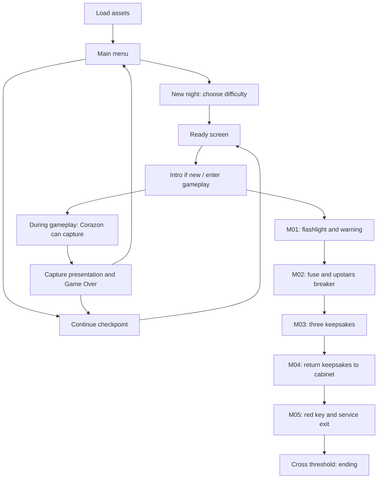

# Corazon: The Haunted House — Complete Game Discussion

**Bisaya/Cebuano-English discussion para sa college project report, demonstration, ug presentation**  
**Implementation reviewed:** October 3, 2026 · project package version `0.1.0`

Kini nga document nag-explain sa **aktuwal nga implemented web game** sa repository. Ang primary basis kay ang current `src/` code, house manifest, loaded GLB assets, configuration, ug tests. Ang older plans ug asset-generation reports gigamit isip supporting history; kung adunay difference, ang current runtime implementation maoy gisunod.

Ang discussion adunay story ug ending spoilers kay intended kini para sa complete project presentation. Ang source links kay relative sa repository aron magamit gihapon kung ibalhin o i-share ang project folder.

## Table of contents

1. [Project overview ug game concept](#1-project-overview-ug-game-concept)
2. [Story ug narrative presentation](#2-story-ug-narrative-presentation)
3. [Game world ug house layout](#3-game-world-ug-house-layout)
4. [Overall gameplay flow](#4-overall-gameplay-flow)
5. [Five missions ug winning requirements](#5-five-missions-ug-winning-requirements)
6. [Desktop ug mobile controls](#6-desktop-ug-mobile-controls)
7. [Player movement, camera, ug stamina](#7-player-movement-camera-ug-stamina)
8. [Jumping ug vertical movement](#8-jumping-ug-vertical-movement)
9. [Interaction, items, ug inventory](#9-interaction-items-ug-inventory)
10. [Flashlight ug battery system](#10-flashlight-ug-battery-system)
11. [Hiding ug tsinelas defense](#11-hiding-ug-tsinelas-defense)
12. [Corazon AI ug navigation](#12-corazon-ai-ug-navigation)
13. [Chase system ug survival decisions](#13-chase-system-ug-survival-decisions)
14. [Kitchen encounter ug jumpscares](#14-kitchen-encounter-ug-jumpscares)
15. [Capture, game over, ug ending](#15-capture-game-over-ug-ending)
16. [Difficulty modes](#16-difficulty-modes)
17. [Audio system ug sound design](#17-audio-system-ug-sound-design)
18. [Haunting, lighting, ug abandoned environment](#18-haunting-lighting-ug-abandoned-environment)
19. [3D assets, animations, ug rigging](#19-3d-assets-animations-ug-rigging)
20. [Collision ug physics architecture](#20-collision-ug-physics-architecture)
21. [HUD, settings, checkpoints, ug pause](#21-hud-settings-checkpoints-ug-pause)
22. [Mobile layout, fullscreen, ug performance](#22-mobile-layout-fullscreen-ug-performance)
23. [Technology stack ug source-code architecture](#23-technology-stack-ug-source-code-architecture)
24. [Running, testing, ug implementation limits](#24-running-testing-ug-implementation-limits)
25. [College presentation guide ug sample answers](#25-college-presentation-guide-ug-sample-answers)

## 1. Project overview ug game concept

**Corazon: The Haunted House** usa ka single-player, first-person, web-based survival horror game. Ang player mosulod sa usa ka karaan nga two-storey house tungod sa usa ka dare, apan ma-lock ang entrance. Kinahanglan niyang mangita sa importanteng items, ibalik ang keepsakes sa balay, ug makagawas samtang naglikay kang Corazon.

Ang title nga **“Corazon: The Haunted House”** diretso nga nagpasabot sa house nga iyang gi-haunt. Ang tagline nga **“Do not enter”** nag-introduce sa central conflict: gisulod sa player ang lugar bisan adunay warning. Ang menu mismo nag-frame sa experience isip **“One house · One ghost · Find your way out.”**

| Aspect | Implemented concept |
| --- | --- |
| Genre | Survival horror with exploration ug objective-based escape |
| Perspective | First-person 3D camera |
| Player setup | Usa ka local player; walay multiplayer session |
| Setting | Karaang furnished house, duha ka floors, ulan ug ngitngit nga atmosphere |
| Main threat | Corazon, nga makakita, makadungog, mangita, mogukod, ug modakop |
| Main objective | Complete the five missions, unlock the service exit, ug molabang sa doorway |
| Survival tools | Walking, sprinting, jumping, line-of-sight breaks, hiding spots, flashlight, ug recoverable tsinelas |
| Platform | Browser with JavaScript/WebGL; desktop keyboard/mouse ug mobile touch input |
| Runtime stack | TypeScript, Babylon.js, Vite, HTML/CSS, ug Web Audio |

Ang challenge gikan sa kombinasyon sa **exploration, resource management, spatial awareness, ug pressure gikan sa ghost**. Kinahanglan kabalo ang player asa siya padulong, pila pa ang stamina, ug unsang corner o hiding place ang makatabang kung magsugod ang chase.

The familiar household spaces and tsinelas defense preserve the local setting. Corazon now uses short, serious English threats; dark rooms, pursuit and close encounters maintain the horror atmosphere.

**Source basis:** [game configuration](src/config.ts), [UI ug story screens](src/ui.ts), [game orchestration](src/game.ts).

## 2. Story ug narrative presentation

### 2.1 Ang premise

Sa intro, ang player gidala sa dare ngadto sa pultahan ni Corazon. Ang photographs anaa gihapon sa mga kwarto, ug ang iyang keepsakes naghulat pa. Dayon molihok ang latch sa luyo sa player. Sa pagsugod sa playable section, ang front door jammed na ug dili magamit isip escape route.

Ang protagonist walay gi-establish nga personal name o full biography sa current game. Ang uploaded female arm mao ang first-person visual asset; wala kini nagdugang ug separate character backstory sa narrative code.

### 2.2 Ang warning ug three keepsakes

Ang warning sa living-room coffee table naghatag sa survival instructions: pangitaon ang kitchen fuse, ibalik ang power sa upstairs breaker, ibalik ang locket, letter, ug music box sa glass cabinet, ug gamiton ang red key sa service exit nga atbang niini.

Ang matag keepsake adunay short story detail:

- **Family locket:** adunay gamay nga portrait nga maampingong gitipigan.
- **Folded letter:** adunay mensahe nga **“Corazon, we left the light on for you.”**
- **Music box:** adunay unfinished melody nga mosunod ang silence.

Kini nga details nagpasabot nga importante kang Corazon ang personal belongings ug memories sa balay. Ang theme sa remembrance ug unfinished attachment usa ka reasonable interpretation sa clues. **Wala pa’y complete origin story, cause of death, o family-history reveal nga gi-establish sa implemented dialogue.** Sa presentation, ipaila kini isip narrative hints, dili confirmed biography.

### 2.3 Unsaon pag-deliver sa story

Ang story gipresentar pinaagi sa menu text, short intro, warning note, objective descriptions, pickup messages, journal, ug Cebuano captions. Dili kinahanglan ug lengthy cutscene aron masabtan ang mission.

Pananglitan, sa kitchen encounter, mo-react ang player sa tingog, mosulti si Corazon og **“You should never have come here.”**, ug mailhan siya sa player. Sa chase adunay **“I know where you are.”** ug **“Don't run from me.”** All current dialogue is clean English. The existing Clean dialogue setting remains compatible with optional recordings.

Sa successful ending, makita ang exchange nga **“Nakuha nimo ang proof?” / “Oo. Dili na ko mobalik.”** Kini ending text; walay implemented camera, photo-taking action, o separate proof-collection objective.

**Source basis:** `WARNING` sa [config](src/config.ts), pickup messages sa [objectives](src/objectives.ts), encounter dialogue sa [game](src/game.ts), intro/ending sa [UI](src/ui.ts).

## 3. Game world ug house layout

Ang playable environment kay usa ka continuous, two-storey house. Ang player mahimong mosaka ug mokanaog pinaagi sa hardwood staircase; ang ghost naggamit usab sa connected navigation sa duha ka floors.

Ang current house manifest adunay **17 named areas**. Ang “area” mahimong room, hallway, passage, staircase, o terrace; dili tanan enclosed bedroom.

| Floor | ID | Area | Gameplay relevance |
| --- | --- | --- | --- |
| Ground | F01 | Entrance foyer & central passage | Starting area, jammed front door, ug main circulation |
| Ground | F02 | Living room | Flashlight ug warning sa coffee table |
| Ground | F03 | Hardwood staircase | Connection padulong sa upstairs hallway |
| Ground | F04 | Dining room | Exploration, dining furniture, ug physical obstacles |
| Ground | F05 | Kitchen | First Corazon encounter, fuse, spare battery, ug tsinelas |
| Ground | F06 | TV room | Exploration ug haunted CRT/radio-style event |
| Ground | F07 | Book passage & CR | Passage, environmental details, ug contextual sounds |
| Ground | F08 | Bar cabinet & escape passage | Keepsake cabinet, red key, ug service exit |
| Ground | F09 | Garage | Letter sa workbench |
| Upstairs | U00 | Landing & hallway | Breaker duol sa Master bedroom 1; access sa rooms |
| Upstairs | U01 | Master bedroom 1 | Exploration ug furnished bedroom context |
| Upstairs | U02 | Study & two beds | Spare battery ug study environment |
| Upstairs | U03 | Guest bedroom | Locket, spare battery, ug wardrobe hiding spot |
| Upstairs | U04 | Twin bedroom | Exploration ug alternate movement space |
| Upstairs | U05 | Shared upstairs CR | Environmental space ug water-related sound events |
| Upstairs | U06 | Master bedroom 2 | Music box ug hanging-clothes hiding spot; initially gated |
| Upstairs | U07 | Front terrace | Outdoor exposure ug connected upstairs exploration |

Ang house data nag-record og **257 original colliders, 17 doorway records, 21 light definitions, 16 windows, ug 231 prop records**. Dili pasabot nga 21 lights ang always active: limitado ang active lights depende sa player location ug graphics quality.

Ang floor rise kay **3.24 metres**. Ang authored staircase adunay visible treads, apan smooth ramp ang navigation support aron stable ang pagsaka ug pagkanaog sa first-person controller.

Tulo ka importanteng progression gates ang gidugang sa runtime: ang front latch nga nagpabiling closed, ang service exit nga kinahanglan ug key, ug ang far bedroom latch nga mo-release human ma-restore ang power. Ang ordinaryong doorways sa layout dili tanan individual open/close puzzles.

**Source basis:** [house manifest](public/assets/models/environments/haunted-house/house-manifest.json), [world loader ug gates](src/world.ts), [house asset documentation](public/assets/models/environments/haunted-house/README.md).

## 4. Overall gameplay flow

Ang experience mosunod niini nga sequence:

1. **Load assets:** basahon ang house manifest ug i-load ang environment, Corazon, arm rig, flashlight, key, ug materials.
2. **Main menu:** start a new night, continue a saved checkpoint, open settings, o tan-aw sa credits.
3. **Difficulty selection:** pilion ang Easy, Medium, o Hard sa bag-ong run.
4. **Ready screen:** ipakita ang controls ug current instruction. Click/tap to play maghatag usab sa browser user activation para sa sound ug applicable display/input requests.
5. **Intro:** short dare-and-latch presentation. Mahimong i-skip, ug automatic kini mohuman human sa roughly 6.5 seconds.
6. **Explore ug complete missions:** collect items, manage flashlight/stamina, ug likay sa ghost.
7. **Capture branch:** kung madakpan, play the capture sequence, show Game Over, ug offer Retry checkpoint o Main menu.
8. **Escape branch:** kung complete ang requirements ug molabang sa service threshold, show the ending ug elapsed run time.

Ang diagram nagpakita sa mission order; mahimo gihapon ang capture samtang nagtrabaho sa later missions. Ang ordinaryong gameplay loop kay **observe → move → inspect/interact → update objectives → react to danger → continue toward escape**.

## 5. Five missions ug winning requirements

| Mission | In-game title | Buhaton sa player | Result |
| --- | --- | --- | --- |
| M01 | Find your bearings | Kuhaa ang flashlight ug basaha ang warning sa living-room coffee table | Ma-establish ang route ug ma-unlock ang fuse progression |
| M02 | Restore the lights | Kuhaa ang fuse sa kitchen counter; i-install sa upstairs hallway breaker near Master 1 | Partial power, far bedroom latch opens, breaker checkpoint |
| M03 | Recover the keepsakes | Kuhaa ang garage letter, guest-bedroom locket, ug far-master-bedroom music box | Keepsake count mahimong `3/3` |
| M04 | Return what belongs here | I-interact ang downstairs glass cabinet with all three keepsakes | Ma-reveal ang red key ug ma-set ang cabinet checkpoint |
| M05 | Leave the house | Kuhaa ang red key, unlock service exit opposite the cabinet, ug step outside | Successful escape |

### 5.1 Importanteng mission rules

Kinahanglan both flashlight ug warning before makuha ang fuse o magamit ang breaker. Ang keepsakes mahimong makit-an sa exploration, apan dili makuha before power restoration. Kinahanglan ang power ug tulo ka keepsakes before mo-release ang cabinet latch. Ang red key available ra human ma-open ang cabinet.

Sulod sa M03, **walay required order sa tulo ka keepsakes**. Ang player mahimong mopili sa route depende sa iyang location ug sa threat ni Corazon.

Ang power restoration kay **partial power**. Modan-ag ang electric fixtures ug ma-release ang far bedroom latch, apan magpabilin ang horror lighting. Ang objective dili automatic nga full-bright house conversion.

### 5.2 Unsa gyud ang win condition?

Ang service exit mahimong i-unlock lamang kung naa ang flashlight, warning, fuse, restored power, three keepsakes, completed cabinet return, ug exit key. Human niini, kinahanglan pa gyud **molabang ang player sa service doorway**.

Sa code, ang crossing gi-check sa ground-floor region sa gawas sa service exit, with `x < -1.9` ug `-14.3 < z < -12.7`, samtang valid ang `canEscape()` requirements. Busa, ang pagkuha lang sa key o pag-click sa door dili pa automatic victory.

Ang front door nagpabiling jammed. Ang earlier compact plan nga adunay utility-room/front-exit route gi-adapt sa existing house layout: **upstairs hallway breaker ug service exit** ang current implemented version.

**Source basis:** [mission guards](src/objectives.ts), [hotspot locations](src/config.ts), threshold check sa [game loop](src/game.ts).

## 6. Desktop ug mobile controls

### 6.1 Desktop

| Input | Action | Practical explanation |
| --- | --- | --- |
| `W A S D` | Move | Forward, left, backward, right relative sa current view |
| Mouse movement | Look | Primary camera control with pointer lock |
| Hold right mouse + drag | Look fallback | Magamit kung unavailable o denied ang pointer lock |
| Arrow keys | Look fallback | Left/right turn; up/down adjust pitch |
| `Shift` | Sprint | Hold samtang moving ug adunay stamina |
| `Space` | Jump | Fresh press while grounded |
| `E` | Interact / hide / leave | Pickups, warning, fixtures, doors, ug designated hiding spots |
| `F` | Flashlight toggle | Available human sa pickup/equip transition |
| Left click | Throw tsinelas | Kinahanglan tsinelas in hand |
| `Tab` | Journal | Missions, inventory, ug warning; `Tab` o `Esc` makabalik gikan sa journal |
| `Esc` | Pause | During gameplay; during intro, skip intro |

Kung mawala ang pointer lock during normal desktop play, mo-pause ang game. Ang fallback camera controls motabang sa environments nga dili mohatag og pointer lock.

### 6.2 Mobile/touch

| On-screen control | Action |
| --- | --- |
| Left joystick | Analog movement; thumb distance controls movement strength |
| Right-side drag area | Camera look |
| Interact | Same item/door/fixture interaction as `E` |
| Jump | Same grounded jump as `Space` |
| Light | Same flashlight toggle as `F` |
| Run | Toggle sprint on/off; dili kinahanglan pirming i-hold |
| Hide / Leave | Enter the focused hiding spot or leave the current one |
| Throw | Throw the held tsinelas |
| Journal | Open missions/inventory |
| Pause | Open pause screen |

Ang joystick, look area, ug action buttons nag-track og separate pointer IDs. Busa mahimong **maglakaw, molingi, ug mopislit sa action button simultaneously**. Ang joystick adunay 10% dead zone aron dili molihok ang player tungod sa gamay nga accidental thumb movement.

Ang disabled controls nagreflect sa state: walay Throw kung walay held tsinelas; walay usable Light before equip; walay Jump while hidden. Airborne Jump input mahimong ma-press apan dili mohatag og another jump.

Sa hybrid device, touch input mopakita sa mobile controls; relevant keyboard movement o mouse press mobalik sa desktop input mode. Ang duha ka input modes nag-feed sa **same player controller ug same game rules**.

**Source basis:** [InputSystem ug Player](src/player.ts), [TouchControls](src/touch.ts), [control labels](src/ui.ts).

## 7. Player movement, camera, ug stamina

### 7.1 First-person movement

Ang player adunay position, yaw, pitch, stamina, flashlight state, hiding state, ug grounded/vertical-motion state. Ang body position nagrepresent sa feet; ang camera gibutang sa eye height.

| Parameter | Current value |
| --- | --- |
| Walking speed at full input | `2.1 m/s` |
| Sprint speed at full input | `3.9 m/s` |
| Eye height | `1.65 m` above feet |
| Collision body height | `1.78 m` |
| Collision radius | `0.23 m` |
| Vertical look clamp | `-1.35` to `+1.35` radians |
| Maximum stamina | `6` units |

Normalized ang movement vector aron walay extra speed kung diagonal ang `W+D`. Sa touch, partial joystick input mahimong hinay nga movement, pero full diagonal input dili mahimong mas paspas kaysa straight movement.

### 7.2 Stamina management

Ang active sprint nga adunay actual movement mogamit og **1 stamina unit per second**. Gikan sa full reserve, roughly six seconds ang continuous sprint before exhaustion.

Human mohunong sa sprint, adunay **1.4-second recovery delay**. Dayon mo-recover ang stamina at **1.25 units per second**, hangtod sa maximum nga 6. Kung exhausted na, kinahanglan maabot ang **1.8 units** before mahimong mo-sprint pag-usab.

Ang sprint dili mag-drain kung ang player nag-press lang sa wall ug wala gyuy horizontal movement. Wala usab separate jump-stamina cost sa current code; sprinting movement gihapon ang resource-consuming action.

### 7.3 Camera feedback ug noise

Adunay subtle walking camera bob kung disabled ang Reduced motion. Mohunong kini in the air ug kung stationary. Ang equipped arm adunay kaugalingong procedural sway nga mosunod sa actual travelled distance.

Ang footsteps adunay gameplay consequence. Ordinaryong walking step nag-emit og hearing radius nga **3 m**, samtang sprint step kay **11 m**, before difficulty multipliers. Ang landing mahimo usab mag-emit og noise: **5 m**, o **9 m** kung sprinting. Ang pag-mute sa speaker volume dili mag-usab niini nga AI noise rules.

**Source basis:** [player controller](src/player.ts), player dimensions sa [manifest](public/assets/models/environments/haunted-house/house-manifest.json).

## 8. Jumping ug vertical movement

Ang jumping kay actual body movement with gravity. Mosaka ang feet/body position ug mosunod ang camera; mao nga makaland ang player ibabaw sa supported furniture.

| Jump parameter | Value | Meaning |
| --- | --- | --- |
| Initial upward velocity | `5.4 m/s` | Kusog sa initial takeoff |
| Gravity | `15 m/s²` | Downward acceleration |
| Terminal falling speed | `18 m/s` | Maximum downward velocity |
| Small floor/stair transition tolerance | `0.20 m` | Support sa smooth floor/stair traversal |
| Theoretical peak above takeoff | `0.972 m` | Approximately one metre, kung walay ceiling collision |

Ang peak makuha sa formula nga `h = v² / (2g) = 5.4² / (2 × 15) = 0.972 m`. Sa level ground, ang ideal time to apex roughly `0.36 s`; ang actual travel mahimong maputol sa ceiling o lahi nga landing height.

Kinahanglan **ground contact ug fresh press**. Walay double jump, mid-air jump reset, o automatic repeated jump tungod lang kay gi-hold ang Space. Kung mohawa sa furniture edge, gravity ang mopakanaog sa player.

Ang collision implementation adunay separate shapes para sa dining-chair seats/backs, bed mattresses/headboards/footboards, ug sofa/armchair seats/backs/arms. Mao nga ang landing support mas angay sa furniture kaysa usa ka giant box ra para sa tibuok object. Ang tables, chairs, beds, boxes, ug counters adunay tests for physical landing/traversal.

Solid gihapon ang walls, closed gates, windows, ug ceilings while jumping. Ang paglukso sa mesa dili automatic protection batok kang Corazon: makakita gihapon siya sa elevated player ug mahimong mopaduol sa reachable edge.

Walay dedicated jump animation clip sa current arm asset. Ang arm mosunod sa physically moving camera, ug ang walking bob/sway input mohunong in the air. Ang supplied pose presets dili gi-present isip complete locomotion or jump animation library.

**Source basis:** [player physics](src/player-physics.ts), [movement tests](tests/movement.test.ts), [difficulty/elevated-player tests](tests/difficulty-display.test.ts).

## 9. Interaction, items, ug inventory

### 9.1 Focus-based interaction

Aron maka-interact, kinahanglan duol ang player, nagtan-aw sa hotspot, ug clear ang line of sight. Ang current maximum focus distance kay **2.15 m**, with per-object targeting radius ug vertical checks.

Kung valid ang target, makita ang interaction marker ug prompt. Ang item sa pikas side sa solid wall dili mahimong kuhaon pinaagi lang sa pag-press og E. Ang foreground arm ug decorative details dili mo-intercept sa interaction target.

### 9.2 Implemented items

| Item | Location | Function |
| --- | --- | --- |
| Flashlight | F02 living-room coffee table | Main portable light ug M01 requirement |
| Warning note | Beside flashlight | Story instructions ug M01 requirement; mahimong basahon pag-usab |
| Fuse | F05 kitchen counter | Requirement para sa upstairs breaker |
| Family locket | U03 guest bedroom | Usa sa three keepsakes |
| Folded letter | F09 garage workbench | Usa sa three keepsakes ug narrative clue |
| Music box | U06 far master bedroom | Usa sa three keepsakes; short melody feedback sa pickup |
| Worn red key | F08 glass cabinet, after return | Pang-unlock sa service exit |
| Kitchen battery | F05 counter | Refill flashlight charge |
| Study battery | U02 | Refill flashlight charge |
| Guest battery | U03 | Refill flashlight charge |
| Tsinelas | F05 kitchen floor, after introduction | Throwable temporary stun; recoverable after throw |

Ang inventory gi-store isip list sa collected item IDs. Wala’y implemented weight limit, crafting system, item-grid management, o manual hotbar. Ang batteries automatic nga i-fit sa flashlight; dili kinahanglan separate reload button.

Ang keepsakes “returned” na sa narrative kung complete ang cabinet interaction, apan ang collected IDs nagpabilin sa progress record. Ang `cabinet` flag mao ang marker nga nahuman ang return. Dili kinahanglan i-drop o i-arrange manually ang tulo ka objects.

Ang duplicate pickups dili makadoble sa progress. Para sa tsinelas, lahi ang **ever collected** record ug **currently in hand** state, kay mahimo kini ihagis ug kuhaon balik.

**Source basis:** [hotspots](src/config.ts), [interaction system](src/interactions.ts), [mission/item rules](src/objectives.ts).

## 10. Flashlight ug battery system

### 10.1 From table pickup to held flashlight

Sa fresh game, ang flashlight anaa sa coffee table, ang first-person arm hidden, ug off ang beam. Sa pickup, ang **same loaded flashlight object** ibalhin gikan sa table parent ngadto sa right-hand socket. Wala’y duplicate table flashlight nga mabilin.

Ang equip transition molungtad og **0.78 seconds**. Mo-rise ang arm, mo-settle ang flashlight sa grip, ug mo-close ang fingers. Human niini mahimong usable ang F/Light ug automatic nga mo-on ang light kung wala nag-hide ang player.

Kung restored checkpoint nga collected na ang flashlight, ready dayon ang held state; dili na i-replay ang table pickup.

### 10.2 Actual lighting

Ang beam kay Babylon **SpotLight** with **14 m range**. Ang position ug direction gikan sa animated flashlight lens socket, busa mosunod gyud sa held prop ang light. Ang flashlight emitter material usab mo-usab sa glow base sa on/off state.

Kung empty ang battery, walay effective beam bisan pa og naka-toggle ang player flashlight flag. Ang hiding mo-switch off sa light ug motago sa arm. Ang player mahimong mo-on balik human mogawas ug available na ang held state.

### 10.3 Resource rules

Ang charge magsugod sa `100`. Mo-drain lamang kung owned, equipped/ready, ug switched on ang flashlight. Ang drain rate ug battery refill amount magdepende sa difficulty.

Ang spare battery automatic nga mo-add og charge, capped at `100`. Kung charge `99` or higher, dili kini i-consume: ang game moingon nga biyaan sa una para dili mausik. Kung below `99`, kuhaon ug i-fit kini bisan pa og ang excess charge ma-cap sa 100.

Ang flashlight makatabang sa visibility ug makapawala sa decorative Corazon afterimages. **Walay flashlight damage o stun rule batok sa real ghost**, ug ang iyang vision formula wala naggamit sa flashlight on/off isip detection multiplier. Ang resource decision kay visibility ug battery preservation.

**Source basis:** [equip state](src/flashlight-state.ts), [rigged viewmodel](src/flashlight-viewmodel.ts), [lighting](src/world.ts), [battery rules](src/objectives.ts).

## 11. Hiding ug tsinelas defense

### 11.1 Designated hiding spots

Duha ang explicit hiding hotspots:

- **Guest bedroom (U03):** hide behind the wardrobe.
- **Far master bedroom (U06):** hide among the hanging clothes.

Kinahanglan naka-focus sa hiding hotspot ug grounded ang player aron makasulod. Press E o tap Hide. Ang hiding mag-stop sa movement, mag-disable sa jumping/throwing, ug mo-off sa flashlight. E, Interact, o Leave makapagawas sa player.

Sa entry mismo, i-check sa game kung **nakakita ba si Corazon sa player**. Kung wala, ang hidden state makatago sa player gikan sa ghost vision. Kung nakita niya ang pagsulod, ma-set ang `hideExposed`, ug adunay warning nga dili siya maprotektahan sa maong hiding place.

Mao kini ang practical rule: **break line of sight first, then hide**. Ang hiding usa ka gameplay state sa designated location; wala’y separate animated wardrobe-interior scene o crouch-anywhere system.

### 11.2 Tsinelas as a temporary defense

Ang tsinelas available human sa kitchen introduction. Kung naa sa kamot, left click o Throw mag-launch niini sa direction sa camera. Ang projectile adunay forward speed, upward component, gravity, ug visible spin.

I-check sa matag update ang travelled segment batok sa solid world ug sa ghost hit volume. Kung ang wall maoy nauna nga naigo, dili ma-stun ang ghost sa pikas side. Kung valid ang ghost hit, temporary siyang ma-Stunned; wala’y damage bar o permanent ghost defeat.

| Behavior | Current rule |
| --- | --- |
| Projectile forward launch | `12 m/s`, aligned sa view direction |
| Added initial upward component | `1.3 m/s` |
| Projectile gravity | `11 m/s²` |
| Stun duration | Easy `2.8 s`, Medium `2.0 s`, Hard `1.5 s` |
| Stun immunity timer | Easy/Medium `6 s`, Hard `7 s`, starting sa successful stun |
| Recovery | Mahulog sa reachable location ug mahimong kuhaon balik |
| Retry behavior | Kung previously collected, mobalik sa inventory on checkpoint restore |

Ang immunity timer nagsugod sa successful hit, mao nga ang listed six/seven seconds **includes the stun interval**. Kini naglikay sa continuous stun-lock kung dali kaayo ang repeated throws.

Ang throw ug landing mo-produce og AI noise with base radius nga **8 m**. Kung miss, mahimo gihapon nga ma-attract ang ghost ngadto sa landing point, depende sa iyang state ug hearing range. Ang landing recovery mangita og reachable navigation point ug adunay origin fallback aron dili mawala permanently ang item sa inaccessible space.

Mahimong makompleto ang escape bisan walay successful tsinelas hit. Ang item kay temporary chance to gain distance, ug wala kini gi-require sa five-mission win condition.

**Source basis:** hiding sa [game](src/game.ts), projectile/recovery sa [interactions](src/interactions.ts), stun rules sa [ghost AI](src/ghost.ts).

## 12. Corazon AI ug navigation

### 12.1 Unsa nga klase sa AI?

Si Corazon naggamit og **rule-based finite state machine**. Sa simple nga explanation, adunay klarong states ug conditions nga magbuot sa iyang sunod buhaton: patrol kung walay threat, investigate kung adunay nadungog, chase kung makita ang player, ug catch kung duol na ug nahuman ang attack windup.

Ang current runtime wala’y TypeSafe/Jev API request, language-model decision loop, o machine-learning adaptation. Ang project-local TypeSafe skill gigamit isip development guidance, apan ang implemented perception, pathfinding, physics, ug progression naa sa ordinaryong TypeScript/JavaScript rules. Ang behavior predictable enough para ma-test, bisan ang incidental horror-event selection adunay bounded randomness.

### 12.2 Seven implemented states

| State | Meaning | Typical transition |
| --- | --- | --- |
| Dormant | Wala pa gi-activate ang threat | Kitchen introduction completes → Patrol |
| Patrol | Mosunod sa predefined patrol destinations sa duha ka floors | Noise → Investigate; valid sight → Chase |
| Investigate | Mopaduol sa nadungog nga position | Sight → Chase; timeout → Patrol |
| Chase | Mogukod sa observed player position | Lost sight long enough → Search; attack completes → Catch |
| Search | Mangita sa last-seen location | Sight → Chase; timeout → Patrol |
| Stunned | Temporary stop human sa valid tsinelas hit | Stun ends → Search |
| Catch | Na-trigger na ang capture | Game controls the capture presentation ug Game Over |

Ang `grace` timer mahimong mopahunong sa ghost action bisan active na ang Patrol state. Ang checkpoint ug reveal protection dili separate visible enemy states.

### 12.3 Vision

Ang `sees()` function nag-check sa mosunod:

1. **Hiding:** kung hidden ug wala nakita ang entry, dili visible ang player.
2. **Vertical separation:** kung labaw sa `1.9 m` ang feet-height difference, dili dayon i-treat nga same visible encounter.
3. **Range:** Easy `7.5 m`, Medium `9.5 m`, Hard `12 m` maximum horizontal detection range.
4. **Facing:** beyond `2 m`, kinahanglan sulod sa forward-facing cone. Ang dot-product threshold kay `0.35`.
5. **Occlusion:** kinahanglan clear ang segment tali sa ghost ug player sample points; walls, colliding furniture, ug closed gates mahimong mobabag.

Kung duol kaayo, within `2 m`, dili na kinahanglan ang forward cone, apan naa gihapon ang ubang checks. Busa, pagduol sa luyo sa ghost dili guaranteed safe.

Ang flashlight status wala niini nga visibility formula. Ang player mahimong makita tungod sa position, facing, range, ug sightline bisan switched off ang light.

### 12.4 Hearing

Ang hearing naggamit sa distance sa ghost ngadto sa supplied noise position, multiplied by difficulty. Kung valid ang sound event, mahimo siyang mo-Investigate.

Wala siya modawat og bagong hearing target samtang Dormant, Catch, Stunned, Chase, o protected by grace. Pananglitan, during Chase, dili dayon mailad ang pursuit pinaagi lang sa another footstep event.

Ang AI hearing wala’y separate wall-occlusion calculation. **Lahi ang gameplay hearing ug audio filtering:** ang player mahimong makadungog og muffled ghost sound through a wall, samtang ang ghost hearing rule mismo radius-based. Ang microphone sa user dili gigamit isip game input.

### 12.5 Pathfinding across the house

Ang shared navigation module naggamit og **A\* search on a `0.2 m` grid**, collision-safe neighbour connections, ug floor/stair links. Adunay direct-segment shortcut kung walkable ang straight route.

Ang pathfinder mo-consider sa existing house colliders ug current dynamic gates. Kung mo-open ang bedroom o exit gate, i-refresh ang affected navigation caches aron updated ang route decisions.

Si Corazon mopili og eight predefined patrol destinations nga naglangkob sa ground floor ug upstairs. Sa normal pursuit, mosunod siya sa physical route around furniture ug through stairs; wala’y normal chase teleport nga mo-skip sa walls.

Kung ang player nagtindog sa furniture nga dili walkable destination para sa ghost, mangita siya sa reachable points palibot niini. Kini nagtugot sa iyang pag-approach sa edge samtang ground-bound gihapon ang navigation.

**Source basis:** [GhostStateMachine](src/ghost.ts), [A* ug shared navigation](scripts/3d-generation/house-navigation.mjs), [perception tests](tests/gameplay.test.ts).

## 13. Chase system ug survival decisions

### 13.1 Detection to pursuit

Human makita ang player for the difficulty-specific reaction time, mosulod si Corazon sa Chase. Adunay detection audio cue, captioned reaction, ug HUD warning nga **“She sees you. Break line of sight.”**

Sa Chase, i-update niya ang last-seen player position. Ang route regularly gi-recalculate; sa clear short segment, mahimo niyang i-follow ang moving target between full repaths. Mas frequent ang repath sa Hard.

Ang motion adunay bounded turn speed ug acceleration. Mobalik siya pinaagi sa shortest rotation arc ug mo-forward lamang kung aligned na sa route. Sa sharp corner, mahimo siyang mo-turn in place before moving, aron malikayan ang backwards/sideways-looking glide.

### 13.2 Breaking the chase

Kung mawala ang line of sight, dili dayon makalimot si Corazon. Adunay short lost-sight allowance; human niini mo-Search siya sa last seen position. Kung walay reacquisition hangtod search timeout, mobalik sa Patrol.

Useful nga sequence sa player kay: **sprint for distance → turn behind a wall/doorway → hide unseen or quietly relocate → recover stamina**. Ang actual success magdepende sa location, remaining stamina, difficulty, ug kung nasaksihan ba ang hiding entry.

Sa Medium, normal chase speed kay `2.4 m/s`, labaw sa `2.1 m/s` walk speed. Ang `3.9 m/s` sprint makahatag og distance, apan limitado sa stamina. Sa Hard, mas taas ang detection ug hearing ug mas taas ang search duration, mao nga mas gamay ang margin sa poor route choice.

### 13.3 Final pressure ug capture reach

Human ma-return ang keepsakes ug mahimong true ang `cabinet` flag, mosaka ang **speed during Chase** ngadto sa final-chase value. Dili kini automatic scripted Chase start; kinahanglan gihapon ang normal perception/state rules. Ang final speed magsugod based sa cabinet completion, dili lang sa exit unlock.

Aron makadakop, kinahanglan visible ang player, within attack distance, ug below `1.78 m` ang vertical separation. Kinahanglan usab ma-maintain ang contact window hangtod matapos ang attack windup. Kung mogawas sa reach o mawala sa sight before that, ma-reset ang attack accumulation.

Ang low furniture mahimong taktikal nga obstacle, apan dili immunity platform. Adunay deliberate checks aron elevated players makita ug ma-approach gihapon.

**Source basis:** [pursuit ug capture conditions](src/ghost.ts), [difficulty values](src/difficulty.ts), [HUD danger cue](src/ui.ts).

## 14. Kitchen encounter ug jumpscares

### 14.1 One kitchen introduction per saved run

Mo-trigger ang first kitchen encounter kung mosulod ang player sa F05, naa na ang flashlight ug nabasa ang warning, ug false pa ang `kitchenSeen`. Ang flag ma-save human makompleto ang encounter.

| Approximate sequence time | What happens |
| --- | --- |
| `0–1.8 s` | Latch sound, short silence, ug player reaction sa strange sound |
| `1.8–3.8 s` | Corazon's face-attack presentation begins; captioned confrontation |
| `3.8–5.8 s` | Player recognition line |
| From about `5.8 s` | Mark kitchen seen, activate real ghost at a reachable position, show fuse/tsinelas guidance, save |

Ang **whole introduction roughly 5.8 seconds**, samtang ang close-up face-attack animation sulod niini kay **1.75 seconds**. Lahi kining duha ka durations.

During the scripted introduction, gi-suppress ang ordinaryong ghost update/capture ug item/throw/hide interactions. During the close-up presentation itself, frozen usab ang movement, look, jump, ug projectile simulation. Human sa encounter, adunay difficulty-specific grace aron makalihok pa ang player.

Ang ghost reveal location gipili gikan sa valid navigation candidates sa kitchen, prioritizing distance gikan sa player. Ang completed kitchen introduction dili na i-replay sa normal checkpoint restore tungod kay retained ang `kitchenSeen` flag.

### 14.2 How the visual scare works

Ang active scare naggamit sa **actual 3D Corazon head ug body**. Ang head gi-frame relative sa camera, adunay neck rotation, body lean, approach, ug final lunge. Adunay dedicated fill light ug viewport/near-plane clearance aron dili ma-clip ang head bisan portrait ang screen o lahi ang camera pitch.

Adunay `face-overlay` element sa UI, apan sa current **spatial** presentation ang flat face image ug “Turn around.” text hidden pinaagi sa CSS. Vignette/support overlay ang gamit niini; ang makita nga attacking face gikan sa 3D model.

### 14.3 Audio synchronization ug duplicate protection

Usa ka guarded `ScareTimeline` ang nagdumala sa timing. Ang kitchen scare adunay reveal beat at `0.16 s`; ang capture sequence adunay reveal beat at `0.38 s`.

Sa reveal render tick, i-trigger ang preloaded `peircing.wavJumpscare.mp3` from its measured 0.20-second impact ug visual reveal together. The source stops at the end of the sequence, before game over or restored play. Kung adunay long frame, ang timeline mohunong una sa reveal beat aron ma-render kini before mahimong matapos ang sequence. Ang duplicate scare starts rejected, ug ang one-shot audio gi-latch aron dili mag-stack sa matag frame.

Kung wala pa ma-load o unavailable ang scare recording, dili kini ipa-play late human sa visual event. Ang gameplay ug ubang available sounds mahimong mopadayon.

### 14.4 Accessibility during scares

**Reduced motion** mopagamay sa head/body motion ug motangtang sa FOV motion; no mode translates or drops the player/camera. **Gentle scares** mopahilayo sa face, mopahumok sa presentation, ug mopaubos sa scare audio. Ang scare timing ug progression nagpabilin.

**Reduced flicker** disables lightning pulses ug flashlight interruption, ug avoids the kitchen electric-light blackout modulation. Ang player mahimong mopili sa settings before o during a run pinaagi sa pause menu.

**Source basis:** [kitchen script](src/game.ts), [scare timeline](src/corazon-motion.ts), [3D presentation](src/corazon.ts), [spatial overlay styles](src/style.css).

## 15. Capture, game over, ug ending

### 15.1 Capture sequence

Kung nahuman ang valid attack windup, mahimong `Catch` ang ghost ug magsugod ang **2.2-second capture presentation**. Kung gikan sa luyo o kilid ang ghost, smooth nga molingi ang camera ngadto sa actual captor before the face fills the view.

Ang movement ug normal actions temporary nga frozen. Adunay head/torso motion, close approach, synchronized scare sound, ug final fade. Ang fade-to-black mahitabo sa last roughly `0.18 s` sa sequence, before ipakita ang caught screen.

Pause/backgrounding mo-freeze sa presentation ug audio. Sa finish/reset, ibalik ang stored camera position, orientation, FOV, model transforms, fog/render groups, ug visibility aron limpyo ang retry o menu transition.

### 15.2 Game Over screen

Ang visible caught screen nag-ingon **“SHE HEARD YOU”** ug **“Not this time.”** Adunay survival reminder ug duha ka choices:

- **Retry checkpoint:** restore the most recently saved progress at its checkpoint anchor.
- **Main menu:** return sa menu, diin available ang saved run kung naa pa.

The jumpscare recording stops when the presentation ends. No tail continues onto the caught screen. Retry, menu return and disposal also stop it.

Wala’y player health bar, medkit loop, o multiple-hit damage system. Ang valid capture mao ang failure trigger. Wala usab lives counter nga mopugong sa sunod retry.

### 15.3 Successful ending

Human makompleto ang objectives, ma-unlock ang service exit, ug malabangan ang threshold, makita ang **“YOU MADE IT OUT”**, **“Never return.”**, elapsed time, ug a serious closing line about a voice inside the house.

I-clear ang run checkpoint sa success. Mahimong mopili og **Another night** para bag-ong difficulty/run o **Main menu**. Ang time usa ka local run result display; wala’y online leaderboard o score-submission feature sa current implementation.

**Source basis:** [capture presentation](src/corazon.ts), [sequence timings](src/corazon-motion.ts), [game-over/ending transitions](src/game.ts), [result screens](src/ui.ts).

## 16. Difficulty modes

Ang player mopili og **Easy, Medium, o Hard** before committing a new night. **Medium ang default.** Ang choice ma-save uban sa progress ug checkpoints; ang older valid saves nga walay difficulty field mahimong Medium.

Pareho ang house, controls, essential items, ug mission requirements sa tanang modes. Ang tuning nag-usab sa enemy pressure, encounter frequency, ug flashlight resources.

### 16.1 Enemy tuning

| Parameter | Easy | Medium | Hard |
| --- | ---: | ---: | ---: |
| Patrol speed, m/s | 0.95 | 1.20 | 1.45 |
| Investigate speed, m/s | 1.30 | 1.65 | 1.95 |
| Normal chase speed, m/s | 1.95 | 2.40 | 2.85 |
| Chase after cabinet, m/s | 2.20 | 2.70 | 3.15 |
| Detection range, m | 7.5 | 9.5 | 12 |
| Hearing multiplier | 0.75× | 1.00× | 1.30× |
| Initial visual reaction, s | 0.90 | 0.35 | 0.15 |
| Attack windup, s | 0.65 | 0.25 | 0.12 |
| Attack range, m | 0.65 | 0.72 | 0.78 |
| Lost-sight allowance, s | 0.80 | 1.35 | 2.30 |
| Search timeout, s | 4.5 | 7 | 10 |
| Investigate timeout, s | 7 | 10 | 13 |
| Chase repath interval, s | 1.20 | 0.90 | 0.55 |

Ang gamay nga reaction/windup values sa Hard nagpasabot nga mas paspas mo-react ug modakop si Corazon. Ang mas taas nga lost-sight/search values nagpasabot nga mas dugay siyang dili mobiya sa pursuit/search attempt.

### 16.2 Grace, defense, resources, ug incidental encounters

| Parameter | Easy | Medium | Hard |
| --- | ---: | ---: | ---: |
| Checkpoint-restore grace, s | 17 | 12 | 8 |
| Minimum grace on checkpoint objective, s | 8 | 5 | 3 |
| Kitchen reveal grace, s | 13 | 9 | 6 |
| Tsinelas stun, s | 2.8 | 2.0 | 1.5 |
| Immunity timer from stun start, s | 6 | 6 | 7 |
| Incidental-event interval multiplier | 1.40× | 1.00× | 0.75× |
| Battery drain, charge points/s | 0.12 | 0.17 | 0.23 |
| Charge from one battery | +70 | +55 | +40 |
| Minimum battery on begin/restore | 40 | 25 | 20 |

Sa encounter multiplier, **mas taas nga interval = mas spaced out nga incidental events**. Ang `1.40×` sa Easy dili mas daghang scares; mas taas kini nga hulat. Ang mandatory kitchen scene ug mission order wala mausab.

Kung continuous ang paggamit gikan sa full charge ug walay refill, theoretical battery duration roughly **13 min 53 s sa Easy**, **9 min 48 s sa Medium**, ug **7 min 15 s sa Hard**. Calculated estimates kini gikan sa `100 / drain`; actual play maglakip sa off time, pause, pickups, ug restore reserves.

Ang minimum battery on restore floor ra, dili replacement sa higher saved charge. Pananglitan, kung Medium save adunay 60, magpabiling 60; kung 10, i-raise kini ngadto sa 25.

**Source basis:** complete tuning sa [difficulty.ts](src/difficulty.ts), restoration sa [game.ts](src/game.ts), [difficulty tests](tests/difficulty-display.test.ts).

## 17. Audio system ug sound design

### 17.1 Usa ka shared mixer

Ang game naggamit og **one Web Audio `AudioContext`**. Ang audio gibahin sa Music, Ambience, Effects, ug Voice buses, with Master control ug dynamics compressor/limiter. Kini nagtugot sa separate volume settings ug controlled sound layering.

| Control | Typical content |
| --- | --- |
| Master | Overall output sa tanang buses |
| Music | MELANCHOLIA, ILI ILI, CreepyNightBreeze, ug synthesized tension/music layers |
| Ambience | Mixkit background bed, CreepyLittleGirl, rain/wind, ug environmental events |
| Effects | Player footsteps, heartbeat, exertion breathing, item/door sounds, proximity warning, ug jumpscare recording |
| Voice | Corazon vocal textures, whispers, ug optional dialogue recordings |

Ang browser audio mag-unlock pinaagi sa click, tap, o key interaction. Kung blocked ang playback, subsequent gestures mahimong mo-retry. Ang audio mute o unavailable sound system dili mo-block sa objectives; naa gihapon ang gameplay ug applicable captions.

### 17.2 Supplied music ug recordings

| Recording | Actual use |
| --- | --- |
| `MELANCHOLIA Music Box Sad, creepy song.mp3` | Main menu, difficulty, ready/pre-game, ug settings/credits opened from menu |
| `ILI ILI Tulog Anay Scary Version Music Box Cover.mp3` | Intro ug gameplay; retained as game track sa caught/ending screens |
| `mixkit-horror-ambience-2482.wav` | Quiet continuous horror bed beneath actual game-music playback |
| `CreepyNightBreeze.mp3` | Extra menu layer with MELANCHOLIA; fades out on game entry |
| `CreepyLittleGirl.mp3` | Gameplay ambience layer; fades out on capture screen, ending, o menu return |
| `CreepyCurseSound.mp3` | Distance-based Corazon proximity warning through Effects |
| `peircing.wavJumpscare.mp3` | Single playback sa face-reveal beat; stops at sequence completion |

Ang duha ka long music tracks nag-share og **one streaming audio element**. Sa track change, adunay `0.8 s` fade out, source switch at silence, ug `0.8 s` fade in. Dili sila duha dungan nga nag-play.

Ang Mixkit source gi-prepare in memory into a roughly **70-second native loop**, with a three-second equal-power overlap sa steady interior. Ang source file wala gi-edit. Adunay low-pass filter ug base gain nga `0.055` before the Ambience/master controls aron subtle ra kini ubos sa foreground sounds.

Matag Corazon recording adunay at most one playback source. Repeated updates o fade reversals dili mag-create og duplicate looping sources.

### 17.3 Proximity warning

Ang `CreepyCurseSound` mosulod kung ang ghost duol sa **8 m**, mahimong mas kusog toward **2 m**, ug mawala kung molapas sa **11 m**. Ang separate entry/exit thresholds naglikay sa rapid on/off switching near one distance boundary; kini gitawag og hysteresis.

Kini nga specific recording distance-based ug mahimong madungog bisan naa si Corazon sa pikas corner. Ang laing shared horror-proximity value adunay wall/floor attenuation ug smooth response, mao nga dili tanang audio cue pareho og exact distance behavior.

### 17.4 Procedural audio ug spatial sound

Ang original Web Audio synthesis naghimo og rain, wind, room tone, wood/tile footsteps, creaks, knocks, scratches, door/latch sounds, item feedback, heartbeat, breathing, ug ghost vocal textures.

Ang listener position/direction mosunod sa player camera. Spatial sources adunay HRTF panning ug distance attenuation; selected sounds adunay low-pass filtering kung occluded, ug ghost voice adunay reverberation. Pananglitan, mahimong ma-feel nga naa sa kilid, luyo, upstairs, o behind a wall ang source.

Ang current room-to-footstep mapping primarily naggamit og **wood ug tile**, with concrete for the outside. Ang synthesis palette adunay metal/dirt options, apan dili pasabot nga every supported sound category adunay separate playable floor area.

Ang heartbeat mosaka uban sa fear, ug breathing motubag sa exertion ug danger. Kini feedback signals sa player state ug threat, dili separate controllable health/sanity meters.

### 17.5 Ten audio atmosphere states

| Soundscape state | Meaning sa experience |
| --- | --- |
| CALM_EXPLORATION | Low-pressure exploration ug base room/weather sound |
| UNEASY | Unsettling room o residual fear |
| CORAZON_NEARBY | Smoothed proximity pressure |
| CORAZON_DETECTED_PLAYER | Brief detection emphasis |
| CHASE | Pursuit rhythm ug threat layers |
| HIDING | Tense concealed-state presentation |
| JUMPSCARE | Foreground scare priority |
| POST_JUMPSCARE | Gradual recovery after the scare |
| GAME_OVER | Caught-screen sound treatment |
| ENDING | Successful escape sound treatment |

Ang music ug ambience **duck**, meaning mohinay, during important dialogue, chase, ug jumpscares. Kung overlapping ang pressure cues, gamiton ang stronger reduction ug smooth recovery. Kini nagpabiling klaro sa critical cues bisan layered ang soundscape.

### 17.6 Spoken dialogue status ug lifecycle

Ang current `VOICE_AUDIO` configuration empty. The authored English dialogue uses **readable captions with synthesized vocal placeholders**, not recorded English voice acting. Ang supplied music/scare recordings lahi sa optional spoken-line manifest.

Ang Clean dialogue mo-usab sa selected caption wording, ug kung adunay future clean/normal voice files, dili mo-fallback sa unclean recording ang clean mode. Ang main dialogue adunay priority kaysa incidental whispers.

Pause ug browser backgrounding mo-suspend sa context ug mag-pause sa streaming track. Resume keeps the track position. Retry/menu/reset mag-clean up sa transient sounds ug pending voice state, including the scare recording, with no caught-screen exception. Ang disposal mo-stop/disconnect sa sources ug close sa context.

**Source basis:** [audio mixer](src/audio.ts), [music lifecycle](src/music.ts), [ambience loop](src/ambience.ts), [recorded audio](src/recorded-audio.ts), [configuration](src/config.ts), [audio credits ug recording manifest](AUDIO_CREDITS.md).
