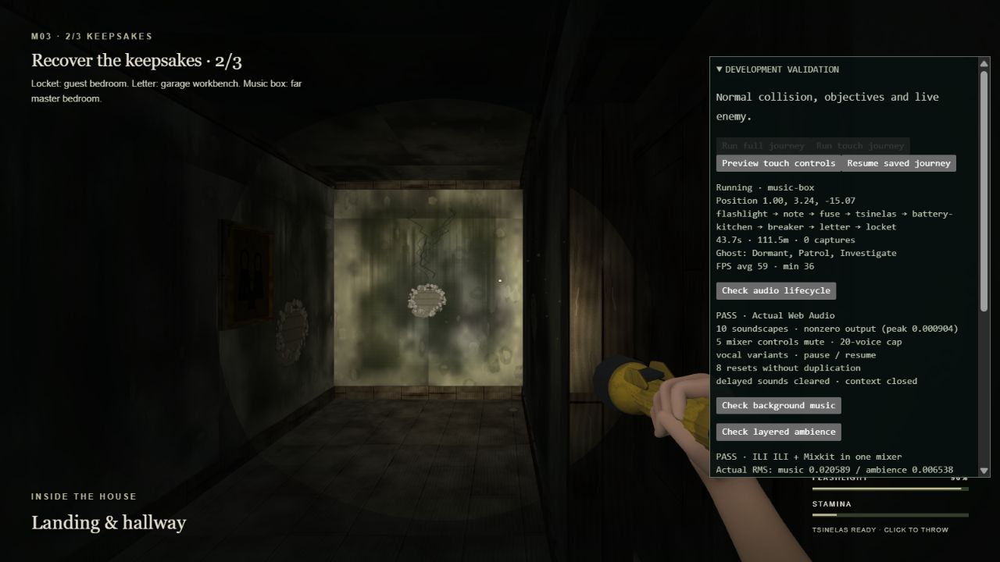
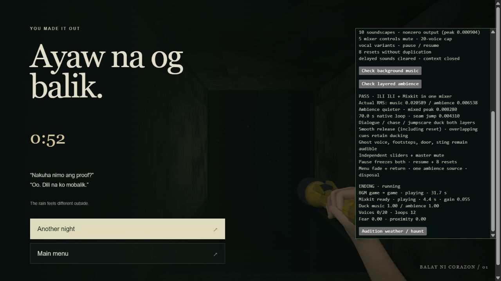

# Layered horror ambience validation — 2026-10-03

The existing ILI ILI MP3, `src/music.ts` streaming player, menu music selection,
autoplay gesture handlers, gameplay and sound-effect implementations are retained.
The new WAV is copied unchanged into `public/assets/audio/` and registered in the
existing Vite runtime-asset list for both production and validation builds.

## Mix and lifecycle

- One AudioSystem and AudioContext own the entire mix. The new layer uses the
  existing Ambience volume control, ambience ducking bus and master compressor.
- ILI ILI remains the main music. Mixkit uses a 0.055 base gain and a 1,800 Hz
  low-pass filter. The original music, effects, voice and default slider levels
  are unchanged.
- The WAV's first second and its fading outro after 74 seconds are excluded
  from the in-memory loop. A three-second equal-power overlap produces a
  70-second stereo AudioBuffer, played by one native looping source. No timer
  schedules loop boundaries, no extra players accumulate, and the decoded
  original is released after preparing the loop. The source file stays intact.
- Ambience starts only when the existing player reports actual ILI ILI playback,
  follows its fade-in envelope, fades out on return to menu, and remains silent
  under MELANCHOLIA. A late WAV decode also fades in rather than starting at full
  gain. Pause/backgrounding freezes the audio clock; resume preserves position.
- Dialogue targets music/ambience gains of 0.42/0.40; chase uses 0.70/0.35;
  jumpscares use 0.08/0.08. The strongest overlapping cue wins. Attack time
  constants are 80 ms (25 ms for a scare), and recovery is 800 ms. Reset also
  releases ducking smoothly. Horror-director silence still applies.
- Effects and voice buses retain their existing levels. A sting no longer
  shortens an ongoing dialogue duck, and recorded lines can duck for their full
  duration. Missing optional dialogue recordings keep their existing vocal
  texture/caption fallback.

## Automated checks

- `npm test`: 37/37 passed, including the existing seven music lifecycle tests.
- The actual supplied WAV was checked across every 100 ms loop window for gaps,
  non-finite samples and clipping, and the wraparound was checked for a new
  discontinuity. Stereo data and the unmodified source were verified.
- Production and validation builds passed, including strict TypeScript checks.
- `git diff --check` passed. `src/music.ts` and the original ILI ILI asset have no
  diff. Built WAV/MP3 files match the source hashes below.

| Asset | SHA-256 |
| --- | --- |
| Mixkit WAV | `9f623396410f8aba9ef85d7bc048272f6d5f2231c6bce51157db582d46625de4` |
| ILI ILI MP3 | `ea2a188ce880a71bad9403cf320dc9b420df457d2a53fe19b17afb95c6d07a5a` |

## Browser validation

The built game was run in the Codex in-app Chromium browser on Windows at
`http://127.0.0.1:4184/`. Audio was uninitialized before the first interaction.
Audits use real button clicks and normal browser autoplay policy; no override or
fake audio output is used. Tests read actual Web Audio samples, not just play
promises or file requests.

The **Check layered ambience** audit covers both real files producing audio at
once, the lower ambience level, native Web Audio rendering across the loop seam,
dialogue/chase/jumpscare ducking and overlapping cue recovery, foreground voice
and effects output, independent sliders, master mute, pause/resume, repeated
resets, menu fade-out/return, single-source reuse and disposal. See
[ambience-browser-report.txt](ambience-browser-report.txt) for measured results.

The original **Check background music** audit passed both real MP3s looping,
MELANCHOLIA → ILI ILI → menu transitions, 0.8-second music fades, independent music
and master mute, pause position, eight resets, and disposal during a transition.
See [ambience-music-regression.txt](ambience-music-regression.txt).

The existing **Check audio lifecycle** audit also passed all ten soundscapes,
foreground vocal variants, the 20-voice budget, all mixer mutes, pause/resume,
eight resets and disposal. See
[ambience-effects-regression.txt](ambience-effects-regression.txt).

The normal desktop journey also completed with the live ghost: all objectives,
the kitchen reveal, chase/capture, checkpoint restoration and the final escape
passed (61.6 seconds of active gameplay, one capture). Both recordings naturally
wrapped during the session and continued through capture, retry and ending;
diagnostics held at 12 permanent sources (the original 11 plus one ambience
source). Browser warning/error logs were empty. See
[ambience-gameplay-report.txt](ambience-gameplay-report.txt).

Audio measurements establish playback, mix headroom and loop continuity. Physical
phone/Safari autoplay and device-specific speaker/headphone listening were not
tested in this Windows browser session.
