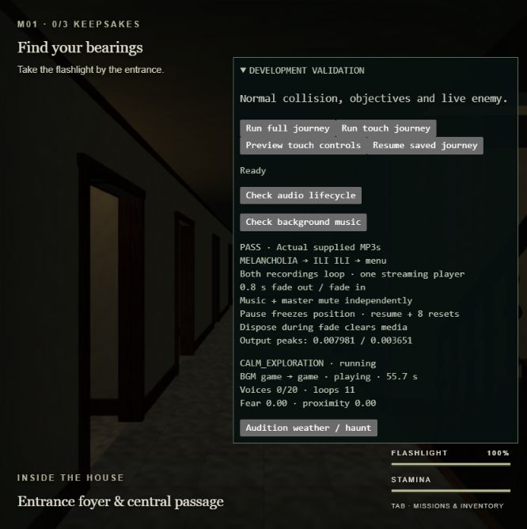
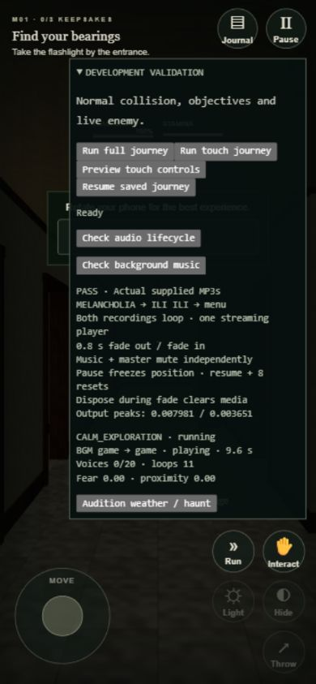

# Background music validation — 2026-10-02

The requested recordings now supply the main background music. MELANCHOLIA
plays on menu, menu settings/credits and the pre-game ready screen. ILI ILI
starts when Click/Tap to play enters the intro or restores gameplay, and stays
selected during gameplay, capture and ending screens. Pause, journal and settings
opened from pause suspend audio. Returning to the menu selects MELANCHOLIA.

## Files and production delivery

Neither recording existed in this checkout, including ignored files, so each
was copied once from the user-specified Downloads path into `public/assets/audio/`.
The names and bytes are unchanged. The build copies these registered runtime
assets into its output; the production copies were also checked against the source.

| File | Bytes | SHA-256 |
| --- | ---: | --- |
| `MELANCHOLIA Music Box Sad, creepy song.mp3` | 5,428,799 | `655c76b750eefce348014d404655a559fe7816a8526944a870bda1a89eaea196` |
| `ILI ILI Tulog Anay Scary Version Music Box Cover.mp3` | 1,463,412 | `ea2a188ce880a71bad9403cf320dc9b420df457d2a53fe19b17afb95c6d07a5a` |

## Automated checks

- `npm test`: **30/30 passed**, including seven music lifecycle tests.
- `npm run build`: **passed**, including TypeScript checking.
- `npm run build:validation`: **passed**, including the browser audit controls.
- `git diff --check`: **passed**.
- Both MP3s are present byte-for-byte in `dist/assets/audio/`.

The music tests cover fade-out before source replacement, fade-in, one reusable
looping player, repeated gestures, rapid selection reversal, preserved position,
pause during a pending switch, a suspended audio clock, rejected autoplay retry,
late playback promises, and disposal during a fade. Songs stream instead of
being decoded in full into mobile memory. Existing game tests remain passing.

## Actual browser checks

Windows, Codex in-app Chromium, built validation preview at port 4174. Standard
browser activation was used; no autoplay policy override was applied.

The **Check background music** audit passed using the real files and Web Audio:

- MELANCHOLIA → ILI ILI → MELANCHOLIA, with the same media element throughout.
- Both recordings loop after seeking near their actual end.
- The outgoing recording fades for 0.8 seconds before replacement; the incoming
  recording fades for 0.8 seconds after playback starts.
- Master output peaks were **0.007981** and **0.003651** with the audit's quiet mix.
  The audit samples past the original quiet opening; the files are not trimmed.
- Music and master volume each independently silence the recorded audio, and
  unmuting restores it.
- Pause freezes media time and the audio context; resume keeps the position.
- Eight resets reuse the context/player; disposal clears a pending switch and
  releases the media source.

The existing **Check audio lifecycle** audit also passed: all ten soundscapes,
actual synthesized output (peak **0.001191**), five mixer mutes, the 20-voice limit,
Corazon vocal variants, pause/resume, eight resets and cleanup. No horror effects,
ambience, footsteps, Corazon textures, jumpscare or environmental cues were removed.

The real UI was checked for initial silence before interaction, first-click menu
playback, menu settings and Credits preserving playback position, the pre-game
ready screen keeping menu music, entry switching to gameplay music, Escape pause,
settings remaining paused, resume and return to menu. Browser warning/error logs
were empty during these checks.

At **390 × 844**, the existing touch-control preview was enabled. In-game music
played with the touch HUD, the Pause button suspended it, and the menu restored
the menu recording. This is a desktop browser layout/control check; it is **not
a physical Android test**. Gesture handling includes pointer down/up, touch end,
click and keyboard, with playback retries and visibility/focus recovery. Actual
Android/Safari autoplay, app switching and lock-screen recovery remain to be
checked on physical devices.

